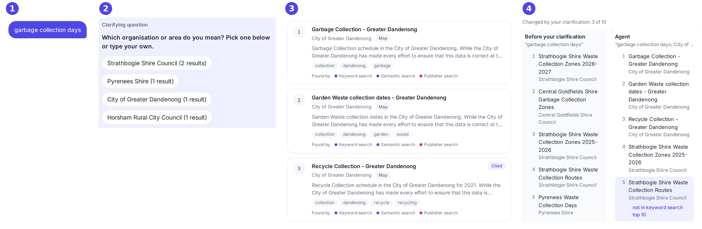

# InterADS: Interactive Agentic Dataset Search

InterADS searches three national open-data portals (data.gov.au, data.gov.uk
and catalog.data.gov) from plain-language queries. It asks back when a query
is vague, links the publisher a query names, and explains how each result was
found.



Demo video: <https://youtu.be/kQANIGx4loE>

## What the system does

- **Asks.** When a query is vague, InterADS asks the user a clarifying
  question with publishers as the options, and the reply restarts the search.
- **Links.** When a query names a publisher in its own words ("Britain's
  national weather service"), InterADS links the phrase to a publisher on the
  portal (the Met Office) and searches that publisher's datasets.
- **Explains.** The answer cites the results, and the interface shows how
  each result was found: a comparison with keyword search, every stage of the
  search, and each record's footprint on a map.

The system has five stages:

1. **Plan.** An LLM call prepares a search plan: the retrieval paths to use,
   the place the query is about, the publisher or dataset it names, and the
   relation between datasets it asks for (datasets related to a named
   dataset, or other datasets of the same publisher).
2. **Retrieve.** Up to five paths run in parallel:
   - Keyword: BM25 over title, description, tags and publisher.
   - Dense retrieval: `bge-small-en-v1.5` embeddings of the query and of each
     dataset (title, publisher, tags, description).
   - Spatial: the place is looked up in a table of place names to get its
     bounding box, and datasets whose footprint overlaps the box are returned.
   - Graph: datasets are nodes, linked when they share at least three tags
     (tags used by more than 150 datasets are ignored). When the plan names a
     dataset and a relation, the path returns the dataset's neighbours ordered
     by shared tags, or other datasets of the same publisher.
   - Publisher: up to 20 candidate publishers are collected by name matching
     (on any word or character trigram of the organisation name, or of an
     official name proposed by the LLM), and a second LLM call picks one of
     them or none. If one is picked, the path returns only that publisher's
     datasets. This step is called publisher linking.

   Keyword and dense retrieval run for every query; the other three paths run
   only when the plan calls for them. Each path returns up to 50 datasets, and
   reciprocal rank fusion (RRF, k = 60) merges them into a pool of up to 50
   candidates.
3. **Decide.** One pass from Plan to Retrieve is a round. After the first
   round, a rule asks a clarifying question when the query names no known
   place, no publisher and no specific dataset, and its top 10 are spread over
   three or more publishers, none of which holds half of them. The options are
   the publishers that appear most often in the top 20, and the reply restarts
   the search with the query followed by the reply. Otherwise, an LLM reads
   the top 10 and either proceeds or proposes a follow-up query for another
   round (at most four rounds).
4. **Rank and answer.** A `bge-reranker-base` cross-encoder scores every
   candidate against the original query. The top 10 are the results, and an
   LLM writes a short answer that may cite only these 10.
5. **Present.** The Standard view shows the results and the cited answer. The
   Comparison view puts the final top 10 next to the top 10 of keyword search
   and of the first round, and tags how each record was found (for example,
   "found via the publisher you asked about" or "after your clarification").
   The Advanced view shows every stage as it runs. Each record page shows the
   record's footprint on a map and why it was returned.

## Test environment

The reported results were produced on one machine:

- Intel Core i7-12700H, 32 GB RAM, NVIDIA RTX 3060 (laptop)
- Qwen2.5-7B-Instruct (`qwen2.5:7b-instruct`) served by Ollama
- OpenSearch 2.19, Neo4j 5
- Python 3.11

## Install

These commands have not been run from this repository as released.

```bash
conda create -n interads python=3.11
conda activate interads
pip install torch==2.6.0 --index-url https://download.pytorch.org/whl/cu124
pip install -r requirements.txt
```

On a machine without CUDA, install `torch==2.6.0` from PyPI instead. The
embedder (`BAAI/bge-small-en-v1.5`) and the re-ranker
(`BAAI/bge-reranker-base`) run on CPU and are downloaded from Hugging Face on
first use.

Use Python 3.11 for the evaluation scripts: from Python 3.12 on, `sum()` over
floats rounds differently, which can change the last digits of the computed
scores.

## Start the backends

These commands have not been run from this repository as released.

```bash
export NEO4J_PASSWORD=<a password of at least 8 characters>
docker compose up -d
ollama pull qwen2.5:7b-instruct
```

`docker-compose.yml` starts one OpenSearch node (port 9200) shared by the three
portals and one Neo4j server per portal (bolt ports 7687 au, 7688 uk, 7689 us).
`config.py` reads `NEO4J_PASSWORD` from the environment; Ollama is expected at
`http://localhost:11434`.

## Fetch the metadata and build the indexes

These commands have not been run from this repository as released.

`benchmark/samples_{au,uk,us}.csv` give the id and portal URL of each sampled
record (8,000 per portal). The metadata are not in this repository (see
[DATA.md](DATA.md)), and the scores in the paper were computed on our copy of
the records.

**Fetching.** The existing harvest and sampling entry points below harvest a
whole portal and then draw a sample; on today's portals they do not give the
same 8,000 records. They write `data/elements.jsonl` (au),
`data/uk/elements.jsonl` and `data/us/elements.jsonl`:

```bash
python ingest/fetch_ckan.py                       # au (CKAN)
CORPUS=uk python ingest/fetch_ckan.py             # uk (CKAN)
export DATAGOV_API_KEY=<your api.data.gov key>    # us: needs your own key
CORPUS=us python ingest/fetch_catalog_api.py
CORPUS=us python ingest/fetch_catalog_api.py --merge
CORPUS=<portal> python ingest/sample_elements.py --geo-frac -1
```

**Building.** For each portal (`au`, `uk`, `us`), once its `elements.jsonl`
exists and the backends are up:

```bash
bash eval/run_clear.sh au python ingest/build_indexes.py --english-subfields --embed-fields full
bash eval/run_clear.sh au python ingest/build_vocabulary.py
bash eval/run_clear.sh au python ingest/build_token_df.py
python ingest/build_publisher_lexicon.py --corpus au
```

`eval/run_clear.sh <portal>` loads the portal's settings (`eval/v4.env`,
`eval/uk/v4.env`, `eval/us/v4.env`), which also name the index. For `us`,
`build_publisher_lexicon.py` reads the publisher names from
`data/us/records_raw.jsonl.gz`, which `fetch_catalog_api.py --merge` writes.

## Start the interface

```bash
bash ui/run_ui.sh --demo
```

This starts one worker per portal and the gateway, waits until every worker
is ready, sends one warm-up question per portal, and prints "ready for demo".
Open <http://127.0.0.1:8000>. `--demo` is the configuration described in the
paper: the comparison view, the grounded clarification rule and publisher
linking. Set `UI_PYTHON` if `python` on the `PATH` is not the environment's
interpreter. Stop everything with `bash ui/stop_ui.sh`.

The two demonstration scenarios in the paper:

| Scenario | Portal | Request | What it shows |
|---|---|---|---|
| S1 | Australia | garbage collection days | the results come from many councils, so InterADS asks which council is meant; picking "City of Greater Dandenong" updates the results, and the Comparison view shows the results before and after the clarification |
| S2 | United Kingdom | weather records from Britain's national weather service | in the Advanced view, the search plan card shows that InterADS linked the phrase to the Met Office and lists the 15 publishers it considered |

## Run the evaluation

These commands have not been run from this repository as released.

The evaluation runs every query of the benchmark through the system. The runs
are long: the full system takes about 30 seconds per query on the test
machine, 200 queries per portal. Run from a fresh shell, so no switch from an
earlier command is still set. For each portal (`au` shown):

```bash
python eval/benchmark_input.py --corpus au --out runs/au

# A1 keyword only (BM25)
bash eval/run_clear.sh au env RERANK_MODE=off python eval/run_eval.py \
    --gold runs/au/topics.json --configs a_keyword --out runs/au/A1.json
# A2 dense only, A3 dense + LLM re-ranking
bash eval/run_clear.sh au env RERANK_MODE=off LLM_RERANK_LOG=runs/au/A2A3.llm.jsonl \
    python eval/run_methods.py --gold runs/au/topics.json \
    --configs e_dense,f_dense_llm --out runs/au/A2A3.json
# A4 keyword + dense + cross-encoder
bash eval/run_clear.sh au python eval/run_eval.py \
    --gold runs/au/topics.json --configs b_fused --out runs/au/A4.json
# A5 InterADS
bash eval/run_clear.sh au env ENTITY_RESOLVE=link_path python eval/run_eval.py \
    --gold runs/au/topics.json --configs d_agent --out runs/au/A5.json
# B2 InterADS without publisher linking
bash eval/run_clear.sh au python eval/run_eval.py \
    --gold runs/au/topics.json --configs d_agent --out runs/au/B2.json
```

Clarification (18 vague queries, au and uk only; `au` shown). C1 sends the
vague query as is; in C2 the system asks a clarifying question and gets
simulated user replies with the removed detail:

```bash
bash eval/run_clear.sh au python eval/run_vague.py --vague runs/au/vague.json \
    --gold runs/au/topics.json --condition noask --configs d_agent --out runs/au/C1.json
bash eval/run_clear.sh au env ASK_STYLE=grounded ASK_MAX=1 USER_SIM=template \
    python eval/run_vague.py --vague runs/au/vague.json \
    --gold runs/au/topics.json --condition ask --configs d_agent --out runs/au/C2.json
```

## Recompute the paper's numbers from `results/`

```bash
python eval/score.py --runs eval/runs_paper.json
```

`results/` holds the top ten of every query in the runs reported in the paper
(see [DATA.md](DATA.md)), and `eval/runs_paper.json` names these files. The
script recomputes Recall@10, nDCG@10 and MRR@10 from each top ten against
`benchmark/gold_<portal>.json`, averages over the four queries of each query
intent and then over query intents, and gives Table 3 (A1–A5) and the numbers
in the Discussion: the drop in Recall@10 without publisher linking (B2) on the
144 publisher queries, and Recall@10 on the 18 vague queries without (C1) and
with (C2) the clarifying question. The Discussion also reports that publisher
linking picks the right publisher for 78 of the 144 publisher queries; this
count needs the publisher names of the gold records, which are not in this
repository, so it cannot be recomputed from the files here. LLM output can
vary between machines, so new runs give close but not identical numbers.

## Tests

```bash
for t in tests/test_*.py; do python "$t" || echo "FAILED: $t"; done
```

The tests run offline (no backend, no LLM). Some parts of
`tests/test_us_fetch.py` and `tests/test_us_places.py` need files that are not
in this repository and are skipped with a message.

## Third-party data and software

- Map tiles: © OpenStreetMap contributors (ODbL), loaded from
  tile.openstreetmap.org.
- State and region boxes for the uk and us portals: derived from Natural Earth
  (public domain).
- Frontend libraries in `ui/static/vendor/`: Vue (MIT), Leaflet (BSD-2-Clause),
  Cytoscape.js (MIT) and the Inter typeface (SIL Open Font License 1.1); their
  licence files are next to them.

## License

The code is released under the MIT License (see [LICENSE](LICENSE)). The
files in `benchmark/` and `results/` are released under CC BY 4.0 (see
[DATA.md](DATA.md)).

## Citation

The paper is under review at the WWW 2027 Demo Track.

```bibtex
@inproceedings{han2027interads,
  title     = {Interactive Agentic Dataset Search: An Agent That Asks, Links, and Explains over National Open-Data Portals},
  author    = {Han, Minghao and Qi, Jianzhong},
  booktitle = {Companion Proceedings of the ACM Web Conference 2027 (WWW '27), Demo Track},
  year      = {2027},
  note      = {Under review}
}
```
